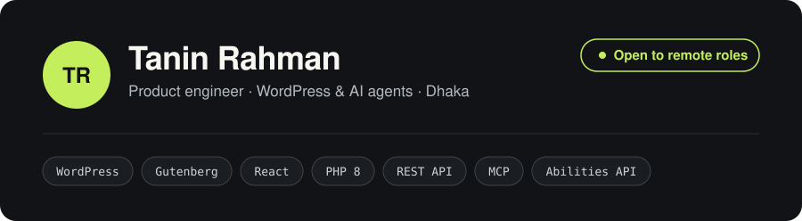
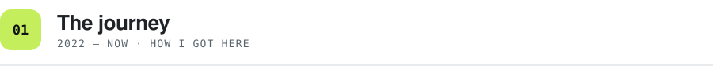
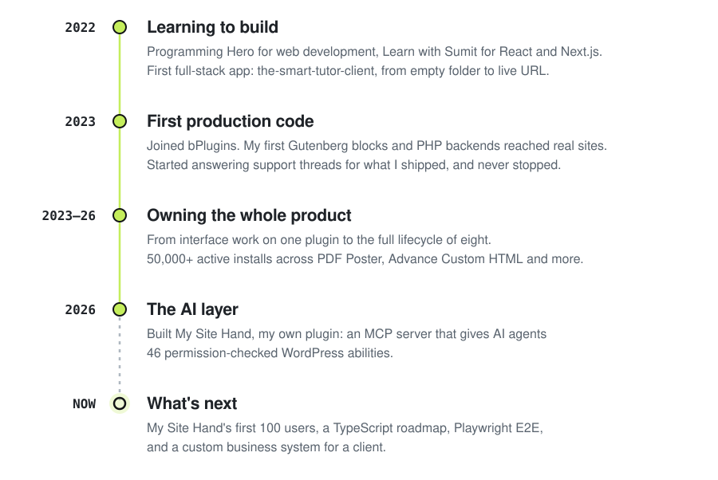
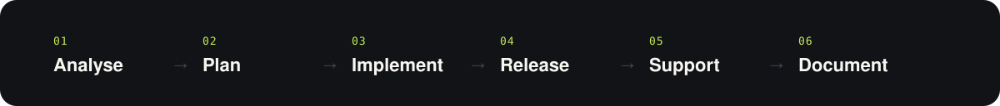

 

&nbsp;
&nbsp;
&nbsp;

Core developer at [bPlugins](https://bplugins.com) since 2023. I build WordPress products end to end, from the first forum question to the release after it, and lately the layer that lets AI agents work on a real site.

 

<picture>
  <source media="(prefers-color-scheme: dark)" srcset="./assets/title-journey-dark.svg">
  
</picture>

<picture>
  <source media="(prefers-color-scheme: dark)" srcset="./assets/timeline-dark.svg">
  
</picture>

First app: [the-smart-tutor-client](https://github.com/taninrahman21/the-smart-tutor-client)

<!-- FILL: one real milestone, e.g. a product you took over or built from scratch, with the year -->

 

<picture>
  <source media="(prefers-color-scheme: dark)" srcset="./assets/title-process-dark.svg">
  
</picture>

**Analyse** — Forum threads, feature requests, and how competitors solve it. 
**Plan** — Scope and approach before code. I'm in product decisions, not only tickets. 
**Implement** — React block, PHP 8 backend, REST endpoints, an admin UI that needs no manual. 
**Release** — Versions, tags, security patches, a consistent changelog. 
**Support** — I answer the forum myself. That is where the next analysis starts. 
**Document** — Plugin docs and a `readme.txt` that never drifts from the code.

 

<picture>
  <source media="(prefers-color-scheme: dark)" srcset="./assets/title-plugins-dark.svg">
  
</picture>

| Plugin | Installs | My part |
|:--|--:|:--|
| [PDF Poster](https://wordpress.org/plugins/pdf-poster/) | 20,000+ | 3D flipbook viewer, admin chatbot |
| [Advance Custom HTML](https://wordpress.org/plugins/advance-custom-html/) | 10,000+ | React editor, live preview |
| [Document Embedder](https://wordpress.org/plugins/document-emberdder/) | 10,000+ | Dashboard redesign, v2.3.0 |
| [Timeline Block](https://wordpress.org/plugins/timeline-block/) | 3,000+ | Layout engine, v2 |
| [Document Viewer](https://wordpress.org/plugins/embed-office-viewer/) | 2,000+ | Viewer block, settings UI |
| [B Timeline](https://wordpress.org/plugins/b-timeline/) | 2,000+ | Layouts, styling system |
| [StreamCast](https://wordpress.org/plugins/streamcast/) | 1,000+ | Player block UI |
| [Voice Feedback](https://wordpress.org/plugins/voice-feedback/) | New | Built from scratch |

bPlugins products, built by a team. The last column is what I built or changed.

<!--
Publish only after the fix has shipped.

**Auditing my own product.** I audited PDF Poster v2.5.2 and found a hardcoded API key, SQL injection and missing nonce checks. They were fixed in [FILL: version]. That is why I treat security as part of the feature, not a last step.
-->

 

<picture>
  <source media="(prefers-color-scheme: dark)" srcset="./assets/title-ai-dark.svg">
  
</picture>

AI assistants talk well about a site but know nothing real about it. **[My Site Hand](https://wordpress.org/plugins/my-site-hand/)** gives them a proper way in:

- **46 abilities** registered through WordPress's Abilities API, each one permission-checked
- **A built-in MCP server**, so Claude Desktop, Cursor and VS Code connect with one generated command
- **Site Health as structured data** an agent can actually reason about

<!-- FILL: The decision I think about most: one real trade-off, e.g. what you chose NOT to expose to agents, or how a wrong agent action is contained, and why. -->

v1.0.0, working toward the first 100 real users. &nbsp;[WordPress.org](https://wordpress.org/plugins/my-site-hand/) · [Source](https://github.com/taninrahman21/my-site-hand)

 

<picture>
  <source media="(prefers-color-scheme: dark)" srcset="./assets/title-toolkit-dark.svg">
  
</picture>

| Area | Tools |
|:--|:--|
| **Front end** | Gutenberg, Block API, React, JavaScript, SCSS, Tailwind |
| **Back end** | PHP 8, WordPress core, REST API, MySQL, Node.js, Express, Firebase |
| **AI** | MCP, Abilities API |
| **Workflow** | Webpack, ESLint, Composer, Git |
| **Learning** | TypeScript, Playwright |

Beyond WordPress

 

**Laravel** — A buy-now-pay-later backend: payment state machine, idempotency, webhooks and a ledger. 
**Client system** — Purchase, production, sales, accounts, HR and field marketing, each with its own permissions. <!-- FILL: stack, if the client allows it. --> 
**In design** — SiteVoice AI, a brand-voice-aware plugin for meta descriptions and excerpts.

<!-- FILL: How I work with AI. Antigravity is my main editor. I use it for [...]. I review [...] by hand, and I don't delegate [...]. -->

 

<picture>
  <source media="(prefers-color-scheme: dark)" srcset="./assets/title-contact-dark.svg">
  
</picture>

Hiring for a product-minded WordPress or full-stack role? I ship, support what I ship, and keep learning.

