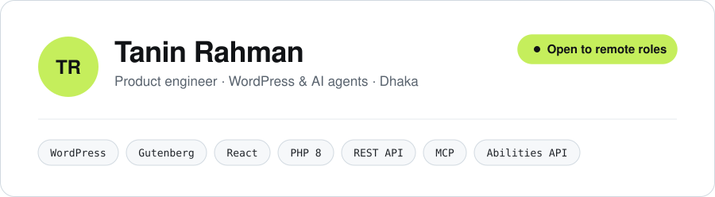

<picture>
  <source media="(prefers-color-scheme: dark)" srcset="./assets/header-dark.svg">
  
</picture>

 

&nbsp;
&nbsp;
&nbsp;

I've built and owned 8 of [bPlugins](https://bplugins.com)' WordPress plugins, used on **50,000+ active sites**. Today I lead four of them, after handing the others to junior developers I mentored. Ownership means the full lifecycle: deciding what to build, building it, releasing it, documenting it and supporting the people who use it.

 

<picture>
  <source media="(prefers-color-scheme: dark)" srcset="./assets/title-journey-dark.svg">
  
</picture>

<picture>
  <source media="(prefers-color-scheme: dark)" srcset="./assets/timeline-dark.svg">
  
</picture>

First app: [the-smart-tutor-client](https://github.com/taninrahman21/the-smart-tutor-client)

 

<picture>
  <source media="(prefers-color-scheme: dark)" srcset="./assets/title-results-dark.svg">
  
</picture>

- **+67% installs.** Grew [Advance Custom HTML](https://wordpress.org/plugins/advance-custom-html/) from 6,000 to 10,000+ active installs while I owned it, by rebuilding it with a React code editor, live preview and syntax highlighting.
- **Fastest-growing of 105.** Owned [PDF Poster](https://wordpress.org/plugins/pdf-poster/) as it became the fastest-growing plugin in bPlugins' 105-plugin portfolio, now at 20,000+ installs, adding 5 viewer modes, document analytics and watermarking.
- **AI with privacy built in.** Pitched, designed and built AI support for [Document Embedder](https://wordpress.org/plugins/document-emberdder/) with the WordPress Abilities API and MCP Adapter. Access is read-only and role-based, so site data stays private.
- **Security.** Found and patched security vulnerabilities across multiple releases.
- **Recognition.** Best Performer Award during bPlugins' "Lightning Support Sunday".

 

<picture>
  <source media="(prefers-color-scheme: dark)" srcset="./assets/title-plugins-dark.svg">
  
</picture>

**Leading now**

#### [PDF Poster](https://wordpress.org/plugins/pdf-poster/) &nbsp;·&nbsp; 20,000+ installs &nbsp;·&nbsp; ★ 4.5

- **5 viewer modes:** Default, Adobe, Flipbook, Scroll and Slider, with progressive loading for large PDFs, a popup lightbox, RTL support and light/dark themes
- **Document Insights:** view and download analytics that work behind page caches, store no IP addresses or cookies, and add per-document reports and CSV export
- **Watermarking:** text or logo marks, tiled coverage, page and audience rules, and a mark that restores itself if someone deletes it
- **More ways in:** a PDF chatbot, social sharing, and native WPBakery and Elementor support
- **Reliability and security:** fixed loading on iOS, Android and CDN-hosted PDFs, CJK text rendering and broken links after site moves; secured REST endpoints and AJAX inputs

#### [Document Embedder](https://wordpress.org/plugins/document-emberdder/) &nbsp;·&nbsp; 9,000+ installs &nbsp;·&nbsp; ★ 4.9

- **AI Agent Access:** AI assistants read documents, stats, leads and Insights through the Abilities API and MCP, with read-only, role-based access
- **Viewers:** 3D flipbook, a custom PDF.js viewer, slideshow and lightbox modes, with lazy and partial loading so large files open fast
- **Downloads and leads:** an email gate with a leads dashboard and CSV export, per-IP limits, role-based access and time-limited download links
- **Growth features:** Document Insights, Box integration, Grid and List library layouts, an Elementor widget and a redesigned admin
- **Security:** fixed a stored XSS issue and hardened download permissions

#### [Document Viewer](https://wordpress.org/plugins/embed-office-viewer/) &nbsp;·&nbsp; 2,000+ installs &nbsp;·&nbsp; ★ 4.7

- **Rebuilt block settings** into four clear panels with plain wording for non-technical users
- **One rendering path:** legacy shortcodes now render through the Gutenberg block engine
- **Content protection:** closed copy, select-all, save and print shortcut bypasses
- **Cleaner core:** Composer autoloading, a restructured codebase and a new admin dashboard

#### [Voice Feedback](https://wordpress.org/plugins/voice-feedback/) &nbsp;·&nbsp; New &nbsp;·&nbsp; ★ 5.0

- **Built from scratch:** feedback drawer, Gutenberg block, shortcode and an admin audio library
- **Admin email alerts** with the recording attached, and a move from AJAX to the REST API
- **Spam control:** an email gate and free Cloudflare Turnstile protection
- **Redesigned dashboard** with a modern settings layout

**Built or grew, now maintained by developers I mentored**

[Advance Custom HTML](https://wordpress.org/plugins/advance-custom-html/) &nbsp;·&nbsp; [Timeline Block](https://wordpress.org/plugins/timeline-block/) &nbsp;·&nbsp; [Timeline](https://wordpress.org/plugins/b-timeline/) &nbsp;·&nbsp; [StreamCast](https://wordpress.org/plugins/streamcast/)

bPlugins products, built by a team.

 

<picture>
  <source media="(prefers-color-scheme: dark)" srcset="./assets/title-process-dark.svg">
  
</picture>

**Analyse** — User feedback, forum threads and competitor research decide what gets built. 
**Plan** — Scope and approach before code. I pitch features, not only take tickets. 
**Implement** — Gutenberg blocks with the Block API, React admin dashboards and live previews, PHP hooks, REST endpoints and shortcodes. 
**Release** — Versions, changelogs, readme files, and security patches when they're needed. 
**Support** — I answer users from many countries on the WordPress.org forums, and fix the conflicts and bugs they find in live products. 
**Document** — Plugin docs that stay in step with the code.

**Beyond the code**, I mentor junior developers on Gutenberg block development, and I'm content manager for bPlugins' WordPress Gutenberg Block Editor Community on Facebook.

 

<picture>
  <source media="(prefers-color-scheme: dark)" srcset="./assets/title-ai-dark.svg">
  
</picture>

AI assistants talk well about a site but know nothing real about it. **[My Site Hand](https://wordpress.org/plugins/my-site-hand/)**, my own plugin, gives them a proper way in:

- **46 abilities** registered through WordPress's Abilities API, each one permission-checked
- **A built-in MCP server**, so Claude Desktop, Cursor and VS Code connect with one generated command
- **Site Health as structured data** an agent can actually reason about

<!-- FILL: The decision I think about most: one real trade-off, e.g. what you chose NOT to expose to agents, or how a wrong agent action is contained, and why. -->

v1.0.0, working toward the first 100 real users. &nbsp;[WordPress.org](https://wordpress.org/plugins/my-site-hand/) · [Source](https://github.com/taninrahman21/my-site-hand)

 

<picture>
  <source media="(prefers-color-scheme: dark)" srcset="./assets/title-toolkit-dark.svg">
  
</picture>

| Area | Tools |
|:--|:--|
| **Front end** | Gutenberg, Block API, React, JavaScript, SCSS, Tailwind |
| **Back end** | PHP 8, WordPress core, REST API, MySQL, Node.js, Express, MongoDB, Firebase |
| **AI** | MCP, MCP Adapter, Abilities API |
| **Workflow** | Webpack, ESLint, Composer, Git |
| **Learning** | TypeScript, Next.js, database design |

Beyond WordPress

 

**Full-stack development** — Before WordPress, I learned to build complete web apps with React, Node.js, Express, MongoDB and Firebase. My first one, [the-smart-tutor-client](https://github.com/taninrahman21/the-smart-tutor-client), used Firebase Auth and went live on Firebase Hosting.

<!-- FILL: How I work with AI. Antigravity is my main editor. I use it for [...]. I review [...] by hand, and I don't delegate [...]. -->

 

<picture>
  <source media="(prefers-color-scheme: dark)" srcset="./assets/title-contact-dark.svg">
  
</picture>

Hiring for a product-minded WordPress or full-stack role? I ship, support what I ship, and keep learning.

